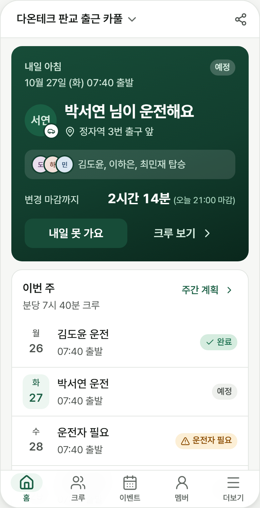
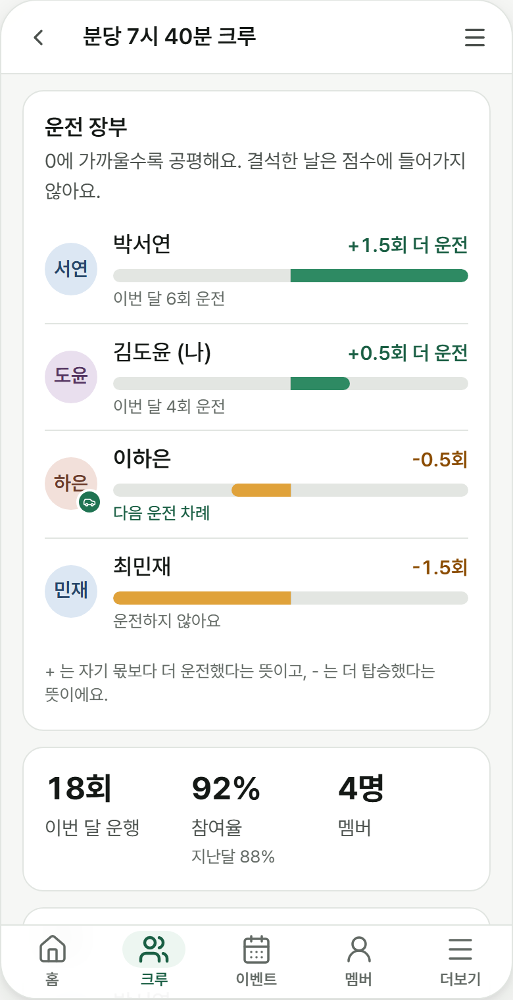
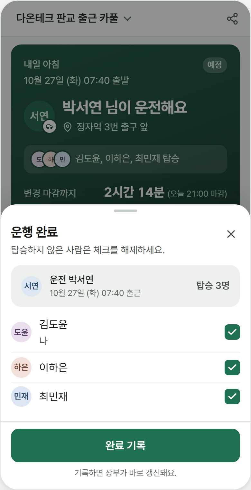

# open-carpool

**이미 서로 아는 사람들의 카풀을 굴러가게 하는 운영 도구.** 회사, 대학, 동호회, 학부모 모임처럼 정해진 그룹이 고정 크루를 짜고, 운전 순번을 공정하게 돌리고, 운행 기록과 기관 보고용 CSV를 한 번에 남깁니다. 모르는 사람끼리 이어 주는 승차 공유 앱이 아닙니다.

*English below.*

<p>
  
  
  
</p>

## 주요 기능

- **그룹과 초대**: 초대 코드·링크로 참여, 이메일 도메인 제한, 관리자 권한과 멤버 관리.
- **고정 크루**: 집 근처와 출퇴근 시간이 겹치는 멤버를 크루로 추천하고, 모두 수락하면 운영을 시작해요.
- **공정한 운전 순번**: Fagin-Williams 방식 장부로 누가 다음에 운전할지 정하고, 결석한 날은 손해 보지 않아요. 홀짝제·5부제 차량 끝번호도 반영해요.
- **내일 계획과 결석**: 홈 첫 화면에 내일 운전자·탑승자·변경 마감 시각, "내일 못 가요"/"운전 못 해요"가 한 번에.
- **운행 기록**: 운행 완료 시 실제 탑승자를 확인하고 장부를 한 번만 반영해요.
- **행사 카풀**: 워크숍·경기처럼 한 번 가는 길에 차를 등록하고 빈 좌석에 타요.
- **부제 짝꿍**: 홀짝제·5부제에서 쉬는 날이 서로 다른 운전자 짝을 찾아 줘요.
- **관리자 대시보드**: 참여율, 운행 수, 좌석 활용, 크루별 출석 감소 신호, 추정 절감 거리·CO2, 월별 CSV 내보내기.
- **한국 법규 기본값**: KR 그룹은 돈을 주고받지 않는 교대 운전 모드만 써요(여객자동차운수사업법 제81조).
- **PWA, 한국어/영어**: 설치형 웹앱, 한국어와 영어 UI.

## 빠른 시작

Node.js 20+와 npm이 필요하고, 에뮬레이터와 보안 규칙 테스트에는 Java 21+가 필요해요.

```bash
npm install
cp .env.example .env.local      # Firebase 웹 앱 설정 값 입력
npm run dev                      # http://localhost:5173
```

실제 Firebase 프로젝트 없이 로컬 에뮬레이터로 실행하려면:

```bash
npm run emulators                                  # Auth + Firestore 에뮬레이터 (Java 필요)
VITE_USE_FIREBASE_EMULATOR=true npm run dev        # 다른 터미널에서
```

에뮬레이터 모드에서는 로그인 메일이 발송되지 않아요. 링크는 `http://127.0.0.1:9099/emulator/v1/projects/demo-open-carpool/oobCodes` 에서 확인하세요.

## 문서

- [자체 호스팅 가이드](docs/SELF_HOSTING.md): Firebase 프로젝트, 환경 변수, Vercel 배포
- [아키텍처와 보안 모델](docs/ARCHITECTURE.md)
- [디자인 시스템](docs/DESIGN.md)
- [로드맵](docs/ROADMAP.md)
- 법률 문서 템플릿: [개인정보처리방침](docs/legal/privacy-policy.ko.md), [이용약관](docs/legal/terms.ko.md) (운영 주체에 맞게 고쳐 쓰세요)

## 라이선스

[AGPL-3.0](LICENSE). 수정한 버전을 네트워크 서비스로 다른 사람에게 제공하면, 그 사용자들에게도 수정한 소스 코드를 공개해야 해요(제13조).

## 기여하기

이슈와 PR 모두 환영해요. 개발 환경, 테스트, 커밋 규칙은 [CONTRIBUTING.md](CONTRIBUTING.md)를 봐 주세요.

---

## English

**An operations tool for carpools among people who already know each other.** Companies, universities, clubs and school-parent groups form fixed crews, rotate driving fairly, and keep ride logs plus a CSV for the institution. It is not a stranger-matching ride-share app.

### Features

- **Groups and invites**: invite code or link, allowed email domains, admin roles and member management.
- **Fixed crews**: suggestions from members who live nearby and share commute times; a crew starts once everyone accepts.
- **Fair driver rotation**: a Fagin-Williams ledger picks who drives next, and missing a day costs nothing. Odd-even and five-day plate rotation are respected.
- **Tomorrow and absences**: tomorrow's driver, riders and change cutoff on the home screen, with "Can't go" / "Can't drive" one tap away.
- **Ride logs**: confirm who actually rode when a trip is done; the ledger is applied exactly once.
- **Event ride board**: offer a car for one-off trips (workshops, matches) and take a free seat.
- **Plate partners**: driver pairs whose plate rotation rest days differ.
- **Admin dashboard**: participation, trips, seats filled, per-crew attendance-drop signals, estimated distance and CO2 saved, and a monthly CSV export.
- **Korean legal defaults**: KR groups always run in no-money rotation mode.
- **PWA, Korean and English UI.**

### Quick start

```bash
npm install
cp .env.example .env.local      # fill in your Firebase web app config
npm run dev                      # http://localhost:5173
# or, without a Firebase project (needs Java 21+):
npm run emulators
VITE_USE_FIREBASE_EMULATOR=true npm run dev
```

### Docs

[Self-hosting](docs/SELF_HOSTING.md) · [Architecture and security model](docs/ARCHITECTURE.md) · [Design system](docs/DESIGN.md) · [Roadmap](docs/ROADMAP.md) · legal templates: [privacy policy](docs/legal/privacy-policy.en.md), [terms](docs/legal/terms.en.md)

### License

[AGPL-3.0](LICENSE). If you run a modified version as a network service, you must offer its source code to the people using it (section 13).

### Contributing

Issues and pull requests are welcome; see [CONTRIBUTING.md](CONTRIBUTING.md).
